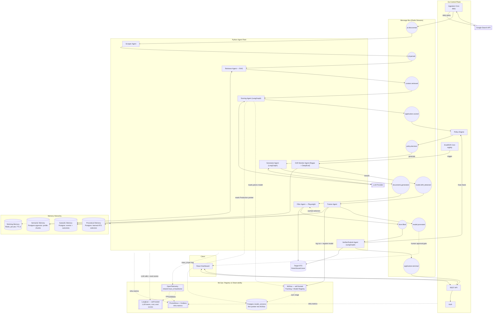
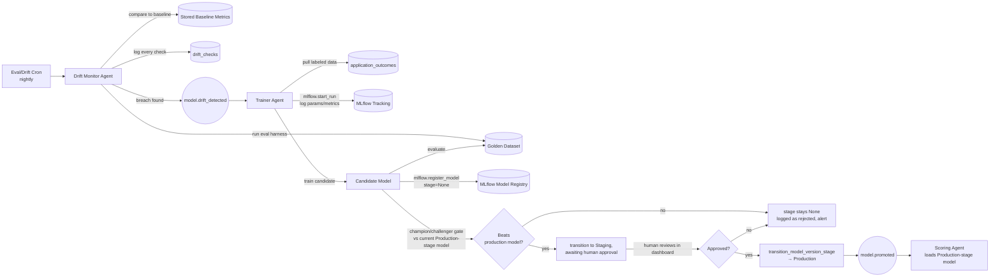
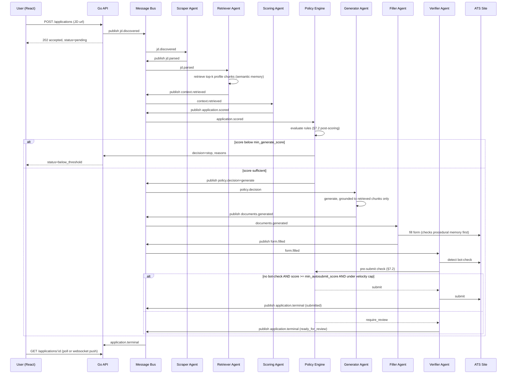

# AgentOS — Technical Design Document (TDD)
**Phase 1: "Apply Agent with Honest Scoring"**

| | |
|---|---|
| Status | Draft v3 — multi-agent architecture + monitoring/MLOps loop |
| Owner | Rajeev Ranjan |
| Date | 2026-08-08 |
| Companion doc | `PRD.md`, `ENTERPRISE_READINESS.md`, `PERFORMANCE_SCALABILITY.md`, `SECURITY_ANALYSIS.md`, `COST_ANALYSIS.md`, `MULTI_TENANCY_AND_PRICING.md`, `IMPLEMENTATION_PLAN.md`, `API_REFERENCE.md` + `../backend/api/openapi.yaml` (frontend-facing API contract) |
| Stack | Go, Python, React |

---

## 1. Design Principles

- The score gate and submit decision are **safety-critical logic**, owned by a single named **Policy Engine** — isolated, deterministic, never touched by anything optimizing for engagement.
- Auto-submit is a narrow, conservative action (no bot-check present **and** score ≥ threshold). Everything else defaults to "prepared, waiting for a human."
- Every agent run must produce structured, queryable data as a side effect, not as an afterthought bolted on later.
- **Agents are independent processes that only talk over the message bus.** No agent calls another agent's code directly — this keeps each one independently testable, replaceable, and scalable, and makes the coordination logic (who runs after whom) inspectable as data (topics/subscriptions) instead of buried in a call graph.
- **Every generated claim must be traceable to a retrieved source.** The Generator Agent never free-associates a candidate's experience — it can only use facts pulled from the Retriever Agent's output. This is what makes "no fabricated experience" an architectural property, not a prompt instruction that can silently erode.
- **Nothing ships without being evaluable.** Retrieval, generation, and scoring all have a fixed offline eval set behind them — quality is a number that can regress and be caught, not a vibe.
- **The system watches itself.** Quality metrics are monitored continuously in production, not just checked at release time — when they drift, that's a signal, and the signal is wired to an actual retraining pipeline, not just a dashboard nobody looks at.
- **Scraped content is data, never instructions.** JD text and ATS page DOM come from the open web and are structurally untrusted — the Ingestion Cron feeds them into the pipeline automatically, with no human in the loop to catch an adversarial posting before it reaches an agent. Every prompt that includes this content keeps it delimited as data, never concatenated into anything an LLM could read as a system-level instruction. See `SECURITY_ANALYSIS.md` §2.1 and §14.1.

## 2. High-Level Architecture



**Why this split across three languages, not one:**

| Layer | Language | Why |
|---|---|---|
| Frontend / review dashboard | **React** | Standard for a stateful review-queue UI (batched approvals, live status); large ecosystem for forms/tables. |
| Control plane: API, auth, ingestion, **policy engine**, scheduling | **Go** | I/O-bound coordination and safety-critical rule evaluation, not AI logic — Go gives predictable concurrency, a static binary that's trivial to deploy, and a natural home for the one component (Policy Engine) that must never be "creative." |
| Agent fleet: scraping, retrieval, scoring, generation, browser automation, drift detection, retraining | **Python** | Playwright, LLM SDKs, embeddings/vector tooling, and ML training libraries (scikit-learn) all have first-class Python support; this is where iteration speed on AI logic matters most and where each agent is small enough to be independently swappable. |

This mirrors a common production pattern: a thin, boring, reliable control-plane (Go) around a rapidly-iterating, multi-agent AI data-plane (Python), coordinated entirely through a message bus, with an observability layer that watches both and a retraining loop that closes back into the data-plane.

**2.1 Frameworks, not just hand-rolled code** — naming what actually implements each piece, rather than leaving it abstract:

| Concern | Framework | Role |
|---|---|---|
| Intra-agent reasoning / tool use / HITL pause | **LangGraph** | Runs *inside* each Python agent that needs multi-step reasoning (notably the Scoring, Generator, and Verifier agents) — see §3.2.1. Does not replace the message bus, which stays the transport *between* agents. |
| RAG evaluation | **Ragas** | Supplies §10.3's metrics directly: `faithfulness` (= our groundedness check), `context_precision`/`context_recall` (= our retrieval recall@k/precision@k), `answer_relevancy`. |
| Agent/generation evaluation (CI gate) | **DeepEval** | Pytest-style golden-dataset harness for §10.2, including a built-in G-Eval (LLM-as-judge) metric for the Generator Agent's rubric score. |
| LLM-specific observability | **Langfuse** (self-hosted) | Traces every LLM call and agent step, tracks token cost, and logs eval scores from Ragas/DeepEval — see §11.1. Self-hosted so trace data stays inside our own infra, consistent with §14's privacy stance. |
| Infra-level observability | **Prometheus + Grafana + OpenTelemetry** | Queue lag, agent latency/error rate, and the cross-agent trace backbone (§11.1) — deliberately kept separate from Langfuse's LLM-specific traces, though both key off the same `trace_id`. |
| Experiment tracking + model registry | **MLflow** (self-hosted) | Training-run history, stage-based model promotion (`None`/`Staging`/`Production`/`Archived`), and model packaging for the Trainer/Scoring Agent handoff — see §11.3/§11.5. **Not Kubeflow**: Kubeflow Pipelines targets distributed, multi-step training DAGs on Kubernetes, which is more infrastructure than a single lightweight calibration model retrained nightly justifies at Phase 1 — see §11.5 for the full reasoning. |

## 3. Components

### 3.1 Go Control Plane
- **API** — REST surface for the React frontend (§9); auth, profile CRUD, application history.
- **Ingestion Cron** — daily job calling the Google Custom Search JSON API **once per active search profile** (§3.1.1 — not once per user; a user with two profiles gets two queries), filtering each result set to the ATS domain allowlist, deduplicating against `discovered_urls`, and publishing a `jd.discovered` message per new posting.
- **Eval/Drift Cron** — nightly trigger (new, §11) that kicks off the Drift Monitor Agent's evaluation pass; kept as a thin Go scheduler for the same reason the Ingestion Cron is Go — scheduling is control-plane concern, the statistical work it triggers is not.
- **Policy Engine** (formalized as its own component, not inline logic — see §7) — the only writer allowed to authorize a `generate`, `submit`, or `require_review` decision. Subscribes to `application.scored` and to the Verifier Agent's pre-submit check; every other agent must wait for a `policy.decision` message before proceeding.

**3.1.1 Search Query Builder** — the Ingestion Cron's query was originally a single hand-written string (earlier PRD §5.0.1). It's now **compiled from structured facets** rather than stored as opaque text, using the same Google search-operator vocabulary the [Google Hacking Database](https://www.exploit-db.com/google-hacking-database) catalogs for precision search — the same operators (`site:`, `intitle:`, quoted exact-phrase, `OR`, `-`exclusion) doing the same job here — narrowing a broad search into a precise one — as they do for security reconnaissance, just pointed at job discovery instead.

**Search profiles, not one flat facet set (fixes the cross-pollination gap).** A single flat facet set means any role term paired with any skill term counts as a match — "senior backend engineer" AND "LangChain" would pass even if that pairing was never intended. The fix: a user configures **one or more named search profiles** (e.g., "AI Engineer track", "Backend Engineer track"), each with its own independent role/skill/location facets. Two profiles compile to two separate queries and run as two separate Ingestion Cron calls — trading Search API quota (`COST_ANALYSIS.md` §2, updated for this) for the precision a single flat query structurally can't give.

**What's per-profile vs. shared** — not everything needed duplicating:

| Scope | Fields | Why |
|---|---|---|
| **Per-profile** (`search_profiles`, §8) | `name`, `role_titles[]`, `title_scoped`, `skill_keywords[]`, `locations[]` | These are exactly the facets whose *pairing* matters — a role and its associated skills belong to the same track, so they live together |
| **Shared across all profiles** (`search_criteria`, §8, now one row per user) | `ats_domain_allowlist[]`, `exclusion_terms[]` | Which platforms to search and what to filter out (recruiter-agency spam, internships) don't vary by role track — forcing a user to re-enter the same exclusion list per profile would be pure friction with no precision benefit |

**Per-profile facets and the operators behind them**, each internally OR'd, then AND'd across facets by juxtaposition — same structure as the original single query, just scoped to one profile:

| Facet | Scope | Operator | Example |
|---|---|---|---|
| Platform | Shared | `site:` | `(site:greenhouse.io OR site:lever.co OR ...)` |
| Role | Per-profile | quoted phrase, `intitle:`-scoped by default | `intitle:("senior AI engineer" OR "AI/ML engineer" OR ...)` |
| Skills/stack | Per-profile | quoted phrase | `("LangChain" OR "LLM" OR "Generative AI" OR ...)` |
| Location | Per-profile | quoted phrase | `("remote" OR "Bangalore" OR ...)` |
| Exclusions | Shared | `-term` / `-"phrase"` | `-"staffing agency" -intern -"contract to hire"` — suggested default, user-editable |

**Profile cap**: max **3 active profiles per user** in Phase 1 — a sane bound on quota cost (each profile is a full daily query) rather than an arbitrary number; most job searches genuinely target 2–3 distinct role tracks, not more. This is also a natural future lever for `MULTI_TENANCY_AND_PRICING.md`'s plan tiers (e.g., free tier = 1 profile) — noted as a connection point, not designed here, since pricing is explicitly out of Phase 1 scope.

**Discovery attribution**: every `discovered` application records which `search_profile_id` produced it (§8) — lets the user (and eventually the product) see which track is actually surfacing good matches, not just that discovery happened.

**Operators evaluated and deliberately not used**: `filetype:` — job postings are HTML pages, not documents, so this operator has no target here; `*` wildcard — considered for partial-title matching, rejected for V1 as too imprecise (risks matching unrelated titles), left as an open question (§17) rather than silently dropped. Naming what was rejected and why is worth doing explicitly — a reader shouldn't have to wonder whether the full GHDB operator set was actually considered.

**Why `intitle:` by default, not a bare keyword match**: a JD page's `<title>` reliably contains the role name; a bare keyword match can false-positive on a page that merely *mentions* a role in body text (a "similar jobs" sidebar, a careers-page FAQ). Same "narrow the surface deliberately" instinct as the ATS domain allowlist itself.

**Operators evaluated and deliberately not used**: `filetype:` — job postings are HTML pages, not documents, so this operator has no target here; `*` wildcard — considered for partial-title matching within a profile, rejected for V1 as too imprecise, left as an open question (§17).

**Why `intitle:` by default, not a bare keyword match**: a JD page's `<title>` reliably contains the role name; a bare keyword match can false-positive on a page that merely *mentions* a role in body text (a "similar jobs" sidebar, a careers-page FAQ). Same "narrow the surface deliberately" instinct as the ATS domain allowlist itself.

**Compilation**: a pure function — no LLM call, no external dependency, deliberately boring, matching the Go control plane's role everywhere else in this design — runs per profile, on two triggers: (1) immediately on `PUT /api/v1/search-profiles/:id`, so the user sees the exact compiled string *before* saving, never a black box (same transparency instinct as the score breakdown, TDD §6.4), and (2) fresh at each Ingestion Cron run per active profile rather than trusting a possibly-stale cache.

**Constraints**:
- **Query length**: the Google Custom Search JSON API has a practical query-length ceiling per query — now a per-profile concern, not a whole-user one, and if anything easier to stay under since each profile's facets are narrower than the old single combined set. The compiler validates length before submission and drops lowest-priority terms first (less-specific skill terms) rather than silently submitting something that doesn't do what the user configured.
- **Term escaping**: user-supplied facet terms are escaped/quoted before compilation so a crafted term can't inject an unintended operator (e.g., an extra `site:` that appears to widen domain scope). This is a correctness safeguard, not the actual security boundary — even if a malformed term slipped through, the Scraper Agent's URL/domain validation (§14.2) is what actually gates which domains get fetched. Defense-in-depth on top of an already-enforced boundary, not the only thing standing between a bad facet and a bad fetch.
- **Quota multiplies with profile count**: each active profile is a full daily Search API call — a user running the max 3 profiles costs 3× the quota of one. `COST_ANALYSIS.md` §2 is updated to price this at a realistic average profiles-per-user rather than assuming one query per user.

### 3.2 Python Agent Fleet
Each agent below is a **separate consumer process**, subscribed to exactly one input topic and publishing to exactly one output topic (§4). None of them call each other directly or share in-process state — anything they need from a previous stage comes from the message payload or from the memory hierarchy (§5).

| Agent | Subscribes to | Publishes | Responsibility |
|---|---|---|---|
| **Scraper Agent** | `jd.discovered` | `jd.parsed` | Fetches the job URL (or accepts pasted text via API), extracts structured JD fields (title, required skills, responsibilities, screener questions). Validates every URL before fetching (§14.2) — this applies to manually-pasted URLs too, not only Ingestion Cron discoveries. |
| **Retriever Agent** (RAG) | `jd.parsed` | `context.retrieved` | Embeds the JD's requirement snippets, retrieves the top-k most relevant chunks from the user's semantic memory (profile/resume corpus) and similar past applications from episodic memory. Full detail in §6. |
| **Scoring Agent** | `context.retrieved` | `application.scored` | Computes JD-fit and resume-match scores from a deterministic keyword/skills-overlap signal, an LLM semantic signal, and retrieval-relevance stats, combined via the currently **promoted calibration model** (§11.3) read from the Model Registry — never the whole raw profile, so the score is traceable to the same evidence the generator will use. |
| **Generator Agent** | `policy.decision=generate` | `documents.generated` | Produces a tailored resume, cover letter, and draft screener answers, constrained to only the facts present in the retrieved chunks (§6). Attaches source-chunk IDs to every generated section for traceability. |
| **Filler Agent** (Playwright) | `documents.generated` | `form.filled` | Opens the target ATS page in a fresh, ephemeral browser context (§14.3 — no shared profile/cookies across users or applications), maps generated content to form fields. Checks procedural memory first for a known-good selector map for this ATS domain before falling back to LLM-assisted DOM analysis. |
| **Verifier/Submit Agent** | `form.filled` | `application.terminal` | Runs bot-check detection immediately pre-submit, asks the Policy Engine for a final go/no-go, and either clicks submit or marks the application `ready_for_review`. |
| **Drift Monitor Agent** (new, §11.2) | Eval/Drift Cron trigger | `model.drift_detected` (conditionally) | Runs the evaluation harness (§10) against recent data via Ragas/DeepEval, compares results to a stored baseline, and raises a drift signal if any tracked metric breaches its threshold. |
| **Trainer Agent** (new, §11.3) | `model.drift_detected` (or manual trigger) | `model.promoted` (after gate + approval) | Retrains the scoring calibration model on fresh labeled outcome data, evaluates the candidate against the golden set, and — only if it passes the champion/challenger gate and a human approves — promotes it. |

**3.2.1 LangGraph's role, concretely** — used inside the Scoring Agent (multi-step: pull signals → call calibration model → attach reasons), Generator Agent (retrieve-constrained draft → self-check citations → revise if a claim isn't grounded), and Verifier Agent (detect → ask Policy Engine → branch on the answer). Its checkpointer is pointed at the **same Redis store as working memory (§5)** rather than standing up a separate persistence layer — a LangGraph checkpoint *is* a working-memory record, not a parallel concept. Its `interrupt()` primitive is what actually implements the `needs_input` pause in the Apply Flow (PRD §5.1 step 8): the agent's graph execution genuinely suspends until the user answers via `POST /api/applications/:id/resolve-input`, rather than the agent polling or re-running from scratch.

### 3.3 React Dashboard
- **Apply** view: submit a JD URL/text, see the score breakdown (with the retrieved evidence it's based on) before committing.
- **Review queue**: list of `ready_for_review` / `needs_input` applications; per-item detail shows the filled form, generated docs, and *which resume facts they were grounded in*; single confirm-submit or batched multi-select confirm.
- **History**: past applications with score, decision, outcome, and (for the curious) which agent run produced which artifact — useful for debugging and for the demo video's "how you built it" walkthrough.
- **Model & Eval view** (new, §11): current promoted model version, recent eval scores, drift alerts, and the one-click approval action for a candidate model waiting on the human-in-the-loop promotion gate.

## 4. Message Bus — Agent-to-Agent Communication

**Transport**: Redis Streams, chosen over introducing Kafka/NATS for Phase 1 — it's already in the stack as the job queue, supports consumer groups (each agent type is its own group, so multiple replicas of the same agent load-balance automatically), and at-least-once delivery is sufficient once consumers are idempotent (§4.2). If agent count or throughput outgrows this, the topic/schema design here ports directly to NATS JetStream or Kafka without changing agent code.

**4.1 Message envelope** — kept intentionally small; payloads are references, not blobs:
```
{
  "job_id": "uuid",
  "trace_id": "uuid",          -- propagated end-to-end, one trace per application (§11.1)
  "event_type": "jd.parsed",
  "produced_by": "scraper-agent",
  "timestamp": "...",
  "payload_ref": "working_memory:job:{job_id}:jd_parsed"   -- pointer into §5 working memory, not inline data
}
```
Keeping large content (JD text, generated documents, DOM snapshots) out of the message itself means the bus stays cheap and fast regardless of payload size, and every agent reads/writes the same working-memory record instead of the message growing at each hop. `trace_id` is the one thing every message carries purely for observability (§11.1), independent of the job's own data.

**4.2 Idempotency** — every consumer keys its side effects on `job_id + event_type`; reprocessing a redelivered message is a no-op if that pair was already handled (recorded in `application_events`, §5). This is necessary because Redis Streams gives at-least-once, not exactly-once, delivery.

**4.3 Ordering** — enforced per-`job_id` only (a single application's messages are processed in order by using `job_id` as the partition key within the stream), not globally — different applications' agents run fully in parallel.

**4.4 MLOps topics**: `model.drift_detected` and `model.promoted` follow the same envelope shape but carry a `model_name`/`version` instead of a `job_id` — they're system-level events, not per-application ones, and are consumed by the Trainer Agent and Scoring Agent respectively (§11).

**4.5 Why this counts as real agent-to-agent communication, not just a job queue**: the Go Policy Engine and the Python agents are separate services owned by separate runtimes, coordinating purely through published events and a shared decision protocol (`policy.decision`) — there is no direct RPC between, say, the Scoring Agent and the Policy Engine. Swapping an agent's implementation (e.g., replacing the Scoring Agent) requires no change anywhere else, only that it keeps publishing the same event shape.

## 5. Memory Hierarchy

Four tiers, each with a distinct storage and lifetime, matched to what actually needs to persist and for how long:

| Tier | What it holds | Storage | Lifetime |
|---|---|---|---|
| **Working memory** | Per-job scratchpad: parsed JD, retrieved chunks, intermediate scores, fill state — the data referenced by `payload_ref` in bus messages | Redis (key per `job_id`) | TTL'd, cleared after the job reaches a terminal state |
| **Episodic memory** | What happened: every stage transition, plus user-supplied outcomes (interview / rejected / no response) | Postgres: `application_events`, `application_outcomes` | Permanent — this *is* the dataset the GTM strategy's moat depends on, and the labeled data the Trainer Agent (§11.3) trains on |
| **Semantic memory** | Durable facts about the user: chunked resume/experience bullets with embeddings, skills, profile fields | Postgres + `pgvector` | Updated on profile edits, otherwise long-lived |
| **Procedural memory** | Learned "how": per-ATS-domain selector maps that worked on a previous fill, refreshed when a fill fails validation | Postgres: `platform_selector_maps` | Long-lived, versioned per domain |

**Why four tiers instead of "just Postgres for everything"**: working memory is deliberately ephemeral and fast (Redis) because it's write-heavy, per-job, and disposable; episodic memory is append-only and permanent because it's the evaluation/outcome dataset; semantic memory needs vector similarity search, which is why it's the one table with `pgvector` rather than plain columns; procedural memory is small and read-heavy (looked up on every fill) and exists specifically to make the Filler Agent cheaper and more reliable over time — a domain it has filled successfully before shouldn't need a fresh LLM-assisted DOM analysis every single time.

Choosing `pgvector` on the existing Postgres instance over a dedicated vector database is a deliberate Phase-1 simplification — one fewer datastore to operate, at the cost of needing to revisit this if the corpus or query volume outgrows it (see §13).

## 6. RAG Pipeline

This is what makes PRD G6 ("no fabricated experience") structurally true rather than a prompt-level promise.

**6.1 Indexing** (on profile save/update): the user's base resume is chunked (by experience entry / bullet point, not arbitrary token windows, so each chunk is a coherent, citable fact), embedded, and written to the `profile_chunks` table (§8) in semantic memory.

**6.2 Retrieval** (Retriever Agent, on `jd.parsed`): the JD's requirement snippets are embedded and used to query `profile_chunks` for the top-k most similar chunks per requirement, plus a secondary query against episodic memory for similar past applications (for score calibration — "you scored 82 on a similar role and it converted"). Output is a ranked, scored list of chunks with their similarity scores — published as `context.retrieved`, not silently discarded after use.

**6.3 Grounded generation** (Generator Agent): the prompt is built *only* from — the JD, the retrieved chunks, and static profile fields (name, contact info, dates). The system prompt explicitly forbids introducing any experience, skill, or claim not present in the supplied chunks. Every generated bullet/sentence in the output is tagged with the `chunk_id` it was derived from; a post-generation pass checks that every tagged claim's key terms actually appear in the cited chunk (a cheap, non-LLM sanity check) before the document is marked ready.

**6.4 Traceability**: `generated_documents.source_chunk_ids` (§8) stores this mapping, so the React dashboard can show *why* a given resume line exists — directly supporting PRD G2's "honest, inspectable" score/generation promise, and giving the review queue something concrete to show a skeptical user (or interviewer).

**6.5 Screener-answer field validation (resolved — closes `SECURITY_ANALYSIS.md` §2.6).** The Scraper Agent (§3.2) classifies each detected screener question's expected field type from the JD/DOM (free text, yes/no, numeric, date, or enum-select) alongside the question text itself. The Generator Agent's answer for that field is checked against the inferred type and a length cap before the document is marked ready — a numeric field getting prose, or a free-text field's answer exceeding a sane length, is a **type/length mismatch**, not a groundedness problem (§6.3 already covers whether the *content* is true; this covers whether the *shape* is right). A mismatch routes to `needs_input` (PRD §5.1 step 8), the same batched-review path already used for fields the pipeline can't resolve at all — reusing existing infrastructure rather than adding a new state.

## 7. Policy Engine

Pulled out as a distinct, named Go component (rather than inline pseudocode) precisely because it's the one piece of logic that must stay boring, auditable, and immune to "just this once" exceptions.

**7.1 Rule model** — declarative config, not hardcoded thresholds:
```yaml
rules:
  min_generate_score: 60
  min_autosubmit_score: 80       # stricter than min_generate_score, deliberately
  require_review_if_bot_check: true
  velocity_cap_per_day: 15       # per-user auto-submit cap, independent of score
  platform_allowlist: [greenhouse, lever]
  max_daily_generate_spend_usd: null   # set per §7.5; recalculated from a rolling average, not hardcoded
```

**7.2 Decision function** — same engine, invoked at two distinct points with different context, so behavior is consistent and centrally auditable:
```
Evaluate(context) -> Decision{action: generate | stop | submit | require_review, reasons: [...]}
```
- **Post-scoring** (`application.scored` → `policy.decision`): score < `min_generate_score` → `stop`; **today's cumulative generation spend ≥ `max_daily_generate_spend_usd`** (§7.5) → `stop`, regardless of score; otherwise → `generate`.
- **Pre-submit** (Verifier Agent's final check): bot-check detected, OR score < `min_autosubmit_score`, OR velocity cap already hit today → `require_review`; otherwise → `submit`.

The `reasons` array is not optional — every decision returns *why*, and that's what the UI renders as the score breakdown / gate explanation, and what `application_events` logs for the permanent record.

**7.3 Enforcement boundary**: the Policy Engine's decision is authoritative and re-checked server-side by the Go control plane before any submit is honored — a compromised or buggy agent cannot talk its way past the gate by claiming a decision it wasn't given. Note this boundary is deliberately untouched by §11's retraining loop — retraining can change *how the score is computed*, never *what the gate does with it*.

**7.4 Bot-check detection** (feeds into 7.2's pre-submit check, executed by the Verifier Agent): heuristic checklist run against the live DOM immediately pre-submit — known CAPTCHA vendor script/iframe presence, `data-sitekey` attributes, honeypot/challenge fields, unexpected redirect to a verification subdomain. Any match is treated as bot-check present. False positives (treating a clean page as gated) are the accepted failure direction — it only costs a manual click, never an unwanted auto-submit.

**7.5 Cost Circuit Breaker** — added after `SECURITY_ANALYSIS.md` §2.5 identified runaway LLM spend (a retry bug, a prompt-injection-induced loop, or just unmodeled growth) as a real availability/financial risk with nothing in the architecture to stop it. Deliberately built as an extension of the existing Policy Engine pattern, not a separate system:

- A lightweight spend monitor (Go, co-located with the Policy Engine) maintains a running total of the current day's generation-related LLM cost, sourced from Langfuse's per-call cost tracking (§11.1) rather than re-deriving it independently.
- When the running total reaches `max_daily_generate_spend_usd`, the monitor updates the Policy Engine's rule state so the post-scoring check in §7.2 starts returning `stop` for every new `generate` decision — **scoring still runs** (it's cheap and is itself a signal worth keeping), only the expensive generation step pauses.
- The cap is not a hardcoded constant — `COST_ANALYSIS.md` §5 recommends setting it as a multiple (2–3×) of the trailing 7-day average generation spend, recalculated periodically rather than fixed once at launch.
- **Resuming requires human action**, mirroring the model-promotion approval gate in §11.4 rather than auto-resetting at midnight: a cap breach is exactly the kind of event that should get looked at, not silently cleared by a timer. The dashboard (§3.3) surfaces the breach and a reset action, audited the same way a policy decision is (§8's `policy_decisions` table).
- `daily_spend` (§8) is the durable record of what the breaker saw and when it tripped — independent of Langfuse, so the audit trail survives even if the observability stack has its own outage.

**7.6 YAML vs. a real rules DSL (resolved)** — Phase 1 stays with YAML config, not OPA/Rego. The current rule set (six rules, §7.1) is entirely threshold/boolean checks with no conditional composition across dimensions — a DSL buys nothing here. The concrete trigger to revisit: **when rules need to compose conditionally across more than ~2 dimensions** (e.g., score × platform × time-of-day × user-tier), or when someone other than the person deploying code needs to edit rules safely. The most likely real trigger is the GTM strategy's Phase 3 recruiter product introducing **per-recruiter-client rule customization** — that's exactly the multi-tenant conditional complexity a real policy engine is for, and a good bet it arrives before any Phase-1-scale internal need does. Not needed now; the trigger is named so this doesn't become a debate re-litigated from scratch later.

## 8. Data Model (Postgres)

```
users(id, email, created_at, ...)
profiles(id, user_id, base_resume_doc_id, skills[], experience_json, ...)

-- semantic memory
profile_chunks(id, user_id, source_section, text, embedding vector(d), created_at)

-- episodic memory
applications(
  id, user_id, jd_url, jd_text, company, role_title, source,   -- manual | discovered
  search_profile_id,   -- nullable (null for manual); which search profile discovered this, §3.1.1
  jd_fit_score, resume_match_score, score_breakdown_json, scoring_model_version,
  status,   -- pending | scored | below_threshold | filling | ready_for_review | needs_input | submitted | failed
  bot_check_detected, submitted_at, created_at, updated_at
)
application_events(id, application_id, event_type, produced_by_agent, payload_json, created_at)  -- append-only; also the idempotency ledger (§4.2)
application_outcomes(id, application_id, outcome, updated_at)  -- user-supplied: interview | rejected | no_response

-- ingestion (§3.1.1): search_criteria is shared config (one row/user), search_profiles is per-track (many rows/user)
search_criteria(
  id, user_id,
  ats_domain_allowlist[],
  exclusion_terms[],
  created_at, updated_at
)
search_profiles(
  id, user_id, name,                  -- e.g. "AI Engineer track", "Backend Engineer track"
  role_titles[], title_scoped,        -- title_scoped: whether role terms are intitle:-wrapped
  skill_keywords[],
  locations[],
  compiled_query_text, compiled_at,   -- last compiled output, for preview/audit — never trust a stale copy at cron time
  active, created_at, updated_at
)                                      -- max 3 active per user, enforced at the API layer
discovered_urls(id, user_id, search_profile_id, url, first_seen_at, application_id)  -- unique(user_id, url)

-- RAG output / traceability
generated_documents(id, application_id, type, storage_ref, source_chunk_ids[], groundedness_score, created_at)  -- type: resume | cover_letter | screener_answer

-- procedural memory
platform_selector_maps(id, ats_domain, field_map_json, last_success_at, failure_count)

-- policy audit
policy_decisions(id, application_id, decision_point, action, reasons_json, rules_version, created_at)

-- cost circuit breaker audit trail (§7.5)
daily_spend(id, date, cumulative_generate_spend_usd, cap_usd, breached, breached_at, reset_by, reset_at)

-- evaluation (§10)
eval_runs(id, run_type, dataset_version, started_at, completed_at)
eval_results(id, eval_run_id, metric_name, value, sample_id)

-- MLOps: thin pointer into MLflow's Model Registry (source of truth), not a duplicate store (§11.3)
model_versions(id, mlflow_model_name, mlflow_version, current_stage, promoted_at, promoted_by)  -- current_stage mirrors MLflow: None | Staging | Production | Archived
drift_checks(id, checked_at, metric_name, value, baseline_value, breached, eval_run_id)
```

`application_events` is the structured log referenced in PRD G4 — every stage transition (scored, gated, filled, submit-attempted, submit-blocked-by-captcha) is a row here, independent of the mutable `applications.status`, so the scoring dataset survives even if later logic changes how status is derived. `policy_decisions` gives the same durability specifically for gate outcomes, separate from the general event log, since it's the audit trail a skeptical reviewer (or future recruiter product) would want first. `applications.scoring_model_version` pins every scored application to the exact model that scored it, so a later model change never silently rewrites the meaning of historical scores.

## 9. API Design (Go, REST)

| Method | Path | Purpose |
|---|---|---|
| POST | `/api/applications` | Submit a JD (url or text) + profile → creates application, publishes `jd.discovered`/`jd.parsed`-equivalent entry point |
| GET | `/api/applications` | List applications (filter by status) |
| GET | `/api/applications/:id` | Detail incl. score breakdown, retrieved evidence, generated docs + source chunks, policy decisions, events |
| POST | `/api/applications/:id/confirm-submit` | User confirms a `ready_for_review` application |
| POST | `/api/applications/:id/resolve-input` | User supplies value(s) for `needs_input` fields |
| POST | `/internal/agent/callback` | Any agent reports a stage result (auth'd service-to-service; internally republishes to the bus where relevant) |
| GET | `/api/profile` / `PUT /api/profile` | Base resume/profile management (triggers re-chunking/re-embedding, §6.1) |
| GET | `/api/eval/latest` | Latest evaluation harness results (§10), surfaced for the demo/debugging, not end-user facing in Phase 1 |
| GET | `/api/mlops/models` | List model versions and MLflow stage (None/Staging/Production/Archived) with their eval metrics (§11.3) |
| GET | `/api/mlops/drift` | Recent drift checks and whether any breached threshold (§11.2) |
| POST | `/api/mlops/models/:id/approve` | Human approval step that actually activates a candidate that already passed the eval gate (§11.3) |

## 10. Evaluation Strategy

Split deliberately into three kinds of checks that answer different questions — "does the code work," "is the agent fleet's output good," and "is the retrieval actually finding the right evidence":

**10.1 Software tests** (unit/integration, CI on every commit):
- Scoring Agent: unit tests against fixed (JD, resume) pairs with expected score ranges.
- Filler Agent: integration tests against a local fixture copy of a real Greenhouse form.
- Policy Engine: adversarial test that no submit is honored when `score < min_autosubmit_score` or `bot_check_detected = true`, even if an agent claims otherwise (defense-in-depth, not trust).

**10.2 Agent evaluation harness** — implemented with **DeepEval**, run as ordinary pytest in CI on every prompt/retrieval/policy config change, and nightly via the Eval/Drift Cron (§11.2 — this is what catches silent quality drift that plain unit tests can't):
- Fixed **golden dataset**: a curated set of (JD, resume, human-labeled expected score, human-approved "gold" tailored bullets) pairs, versioned (`eval_runs.dataset_version`) and loaded as a DeepEval `EvaluationDataset`.
- **Scoring Agent**: mean absolute error vs. golden score labels; calibration check (does a score of 80 actually mean ~80% of similar historical applications were a good fit) — this calibration metric is also the primary drift signal in §11.2.
- **Generator Agent**: DeepEval's `GEval` metric (LLM-as-judge) scoring relevance, tailoring quality, non-repetitiveness — tracked as a trend, not a hard gate, since it's inherently noisier than the deterministic checks.
- **Filler Agent**: field-fill success rate against the fixture set.
- Results land in `eval_runs`/`eval_results` (§8) and are surfaced via `GET /api/eval/latest` — concrete numbers to show in the "how you built it" section of the demo video, not just a claim that evaluation exists.

**10.3 RAG evaluation** — implemented with **Ragas**, specific to the Retriever/Generator pair since this is the part carrying the "no fabricated experience" promise:
- **Retrieval quality**: Ragas `context_precision` / `context_recall` against a labeled set of (JD requirement snippet → expected relevant profile chunk) pairs — the library implementation of what §6.2 calls recall@k/precision@k.
- **Groundedness/faithfulness**: Ragas `faithfulness` metric run on every generated document, backed by the cheap post-generation citation check from §6.3 as a first-pass filter before the (more expensive) Ragas LLM-as-judge pass runs on a sample. Score stored as `generated_documents.groundedness_score`.
- **Hard-gate threshold (resolved):** Phase 1 launches with groundedness **logged/tracked only**, per the cold-start reality that there's no golden dataset yet to calibrate a threshold against (§16) — a hard gate set from vibes risks blocking legitimate documents as often as catching bad ones. It becomes a **hard gate at Ragas faithfulness < 0.7** once the golden dataset (already required for §10.2 regardless) has enough labeled examples to confirm that threshold's false-block rate is acceptable; the number itself should be validated against real data before it's enforced, not treated as final on paper. Below 0.7, the document doesn't reach `ready_for_review` — it routes back through the Generator with the citation gaps flagged, the same recovery path a citation-check failure already uses (§6.3).
- Both DeepEval and Ragas results are also pushed to Langfuse (§11.1) as scores attached to their originating trace, so a low score is one click away from the exact LLM calls that produced it — not just a number in isolation.

## 11. Monitoring & MLOps Feedback Loop

This closes the loop the rest of the document sets up: episodic memory (§5) exists partly to feed this, the eval harness (§10) is what both detects drift and grades retrain candidates, and the Policy Engine (§7) is explicitly never touched by this pipeline — only the Scoring Agent's calibration weights are, keeping the score gate's thresholds stable and human-set even while the underlying scoring model improves.



**11.1 Monitoring stack** — two purpose-built tools, not one tool stretched to cover both jobs:
- **Infra-level (Prometheus + Grafana)**: Prometheus scrapes `/metrics` from the Go control plane and every Python agent — request rate, latency histograms per agent, error rate, message-bus consumer lag/unacked count per topic, Playwright fill success/failure rate. Grafana dashboards organized by question, not by component:
  - *System health* — per-agent latency/error/throughput, consumer lag.
  - *Pipeline funnel* — conversion at each stage (discovered → scored → generated → filled → submitted/ready_for_review), so a drop-off is visible immediately, not inferred later from application history.
  - *Safety* — count of auto-submits on applications where `bot_check_detected = true`. This must stay exactly 0; it's alerted on immediately, not just dashboarded, since it's the one metric where "slightly off" is already a failure (see PRD §8 Safety metric).
- **LLM-level (Langfuse, self-hosted)**: every LLM call made by any agent — Scoring's semantic pass, Generator's drafting, DeepEval's/Ragas's judge calls — is traced in Langfuse with full prompt/response, token count, and cost. DeepEval and Ragas scores (§10.2/§10.3) are attached to their originating trace as Langfuse scores, so a *Quality trend* dashboard (retrieval recall@k, groundedness, scoring calibration error, generation judge score over time — the same view the Drift Monitor reads programmatically, §11.2) lives here, not in Grafana. Self-hosted specifically so this trace data — which can include resume/JD content — stays inside our own infra, consistent with §14.
- **Shared tracing backbone**: the `trace_id` added to the message envelope (§4.1) is the same ID propagated into Langfuse's traces via OpenTelemetry, so a single application's full journey — Scraper → Retriever → Scorer → Policy → Generator → Filler → Verifier — is one trace spanning both systems: Grafana shows the infra hop timings, Langfuse shows what was actually said to the LLM at each hop. This is the concrete thing to pull up live in the demo video when explaining "how you built it."
- **Logging**: structured logs correlated by `job_id`/`trace_id`, shipped to a log aggregator (e.g., Loki). `application_events` remains the durable *business*-level audit log (§8); logs are the *operational* debugging layer — deliberately kept separate so operational noise never pollutes the permanent scoring dataset.

**11.2 Drift detection**
The Drift Monitor Agent runs nightly (triggered by the Go Eval/Drift Cron) and re-runs the §10.2/§10.3 evaluation harness against a recent data window, then compares each metric to a stored baseline:
- Scoring calibration error (MAE between predicted score and actual outcome-derived fit) exceeds threshold.
- Retrieval recall@k drops below threshold.
- Groundedness score drops below threshold.
- Input distribution shift — e.g., the proportion of JDs from role categories underrepresented in the training/eval set spikes (a simple category-frequency or population-stability check).

Every check is logged to `drift_checks` regardless of outcome (so "nothing was wrong" is itself a recorded, queryable fact, not silence). On a breach, the agent publishes `model.drift_detected` with the specific metric and magnitude — this is a monitoring signal, not by itself a retrain trigger, which avoids reacting to single-run noise (the Trainer Agent decides whether the breach warrants a full retrain).

**11.3 Retraining pipeline — implemented with MLflow, not hand-rolled**
- **What actually gets trained**: the **Scoring calibration model** — a small model that combines the deterministic keyword-overlap signal, the LLM semantic score, and retrieval-relevance stats into a final calibrated fit score. This is trained on `application_outcomes` (labeled: interview / rejected / no response) once enough labeled data exists. Everything else — the LLM calls themselves — stays a pretrained, swappable API; Phase 1 does not fine-tune an LLM. Before any real training data exists, the "model" is just the fixed heuristic weighting already described in earlier drafts of this doc (§10.2) — training only kicks in once there's outcome data worth learning from (see §16 Known Gaps).
- **Minimum labeled outcomes before entering the gate (resolved):** a candidate calibration model only enters the champion/challenger gate once there are **at least 150 labeled `application_outcomes`, with at least 30 in each outcome class** (interview / rejected / no-response, collapsible to a binary "confirmed good fit" vs. not for calibration purposes). This follows the standard small-model rule of thumb (roughly 10–20 examples per model parameter for a low-parameter model like this one, plus needing both classes meaningfully represented) rather than an arbitrary round number. Below that threshold, the Scoring Agent keeps running on the fixed heuristic — training runs anyway (cheap, and useful to sanity-check the pipeline), but candidates below this count never reach `Staging`.
- **MLflow Tracking**: the Trainer Agent wraps each retrain in `mlflow.start_run()`, logging hyperparameters, the training dataset version, and eval metrics (MAE, calibration error) as MLflow metrics — this is the actual experiment log; `eval_runs`/`eval_results` (§8) stay the record for *Ragas/DeepEval* runs specifically, MLflow owns the record for *training* runs. Two different kinds of "experiment," not a duplicate system.
- **MLflow Model Registry**: a successfully trained candidate is registered via `mlflow.register_model()`. Promotion state uses MLflow's own stage model directly — `None` (just trained) → `Staging` (passed the eval gate, awaiting human approval) → `Production` (approved, live) → `Archived` (superseded or rejected) — rather than reinventing a parallel status enum. The `model_versions` table in Postgres (§8) is now a **thin pointer**, not the source of truth: `model_versions(id, mlflow_model_name, mlflow_version, current_stage, promoted_at, promoted_by)`, kept in sync via MLflow's registry webhooks/API so `applications.scoring_model_version` (§8) can join against it without every request hitting the MLflow server.
- **Champion/challenger gate**: the candidate is only promoted if it beats the **current `Production`-stage model's logged metrics** (pulled from MLflow Tracking) on the metrics that triggered the retrain, and doesn't regress the others — never promoted purely because a new version exists.
- **Model packaging**: candidates are saved as `mlflow.pyfunc` models, so the Scoring Agent loads whichever version is currently in the `Production` stage through the standard MLflow model-loading API — no custom serialization format to maintain.

**11.4 Human-in-the-loop promotion gate**
Consistent with §1's principle that safety-critical logic must stay auditable: passing the eval gate moves a candidate to MLflow's `Staging` stage, not `Production` — necessary but not sufficient. A human approves it via `POST /api/mlops/models/:id/approve` in the dashboard, which calls MLflow's `transition_model_version_stage()` to move it to `Production`; only then does the Scoring Agent switch to it (on `model.promoted`, or its next periodic version-refresh check).

**Auto vs. human promotion, long term (resolved):** the answer is not a single yes/no — it splits by what's being promoted. The **Policy Engine's own thresholds** (`min_generate_score`, `min_autosubmit_score`, and everything else in §7.1) never go auto — those are the safety-critical gate itself, and §7.3 already establishes that retraining can change how the score is computed but never what the gate does with it; that boundary doesn't get softer over time. The **calibration model's promotion**, by contrast, is a narrower decision (does this version score better than the last one) that can earn conditional automation: once **10 consecutive candidate models have been human-approved with no rollback and a champion/challenger improvement above a set margin**, auto-promotion can be enabled for that specific pipeline, with human review becoming a post-hoc audit (reviewed after the fact, still logged in `policy_decisions`) rather than a pre-approval gate. A single incident resets the counter to zero. This gives Rajeev an actual answer to the "does the human step stay permanent" tension instead of leaving it open indefinitely — the human step stays permanent for the gate, earns automation for the model, and the two were never the same question.

**11.5 Why MLflow, and deliberately not Kubeflow**
MLflow is adopted because it directly replaces three things this design was otherwise hand-rolling: experiment tracking (training run history), a model registry (stage-based promotion, exactly matching the candidate/gate/promote flow above), and model packaging (a standard load path for the Scoring Agent). It's a library plus a lightweight tracking server, self-hosted for the same reason as Langfuse (§14) — training data and model artifacts stay inside our own infra.

**Kubeflow is deliberately not used in Phase 1.** Kubeflow Pipelines solves a different problem than the one this system has: orchestrating multi-step, distributed training DAGs across a Kubernetes cluster, typically for large models or multi-team ML platforms. Phase 1's actual training job is a single lightweight calibration model (a handful of features, no GPU, dataset size bounded by one user's application history) triggered nightly by an event on the existing message bus — introducing a Kubernetes-native pipeline orchestrator here would mean standing up and operating a K8s cluster and KFP itself purely to run something that's currently one Python function call. This is the same "boring over impressive" judgment already applied elsewhere in this doc (pgvector instead of a dedicated vector database, §5; Redis Streams instead of Kafka, §4).

**Revisit trigger (resolved — no longer open):** any *one* of these three conditions is sufficient to justify Kubeflow, not all three: (1) a second trainable model enters production alongside the calibration model (e.g., a future groundedness classifier); (2) the training pipeline grows a genuinely multi-stage shape — separate feature-engineering, training, and evaluation steps needing independent retry/scaling, not just "more code in one Python function"; (3) the team grows past solo and a second engineer needs pipeline visibility that MLflow's flat run list doesn't provide. Named explicitly so this isn't re-litigated from scratch later — the first of these three to actually happen is the signal, not a scheduled re-review.

## 12. Sequence — Happy Path Apply (message-driven)



## 13. Scalability

- Every agent is a stateless consumer group member — queue depth per topic drives that agent's replica count independently (e.g., more Retriever replicas without touching the Filler Agent). For Phase 1 (single user, demo scale) this is a non-issue; designed this way so it isn't a rewrite later.
- Go control plane is stateless behind the DB/bus, scales trivially.
- Playwright browser instances (Filler Agent) are the actual bottleneck — worker pool size is capped by browser instance count, not by Go/Python throughput.
- `pgvector` similarity search is fine at Phase-1 corpus size (single user's resume, low thousands of chunks); revisit if the corpus grows to many users' full histories (open question, §17).
- The Drift Monitor/Trainer Agents run on a nightly schedule at Phase-1 scale, not continuously — no scaling concern until retraining needs to happen more often than daily.

## 14. Security & Privacy

- Per-platform credentials (if login is required to apply) stored encrypted at rest, scoped per-platform, revocable per-platform — not a single blanket "connect your accounts" grant (Cowork-style permission model referenced in the GTM doc §4).
- Generated documents and JD text stored in object storage with per-user access control; only `storage_ref` travels through Postgres/messages, not raw blobs.
- `/internal/agent/callback` is service-to-service authenticated (shared secret/mTLS), not reachable from the public API surface.
- Message bus payloads are references (§4.1), not raw PII — reduces what's sitting in the bus's own storage/logs at any point in time.
- No credential or resume content is ever sent to the LLM provider beyond the specific retrieved chunks needed for that call (no bulk profile dumps in prompts) — a direct consequence of the RAG design in §6, not a separate rule to remember to follow.
- Prometheus metrics and traces (§11.1) carry `job_id`/`trace_id` and latency/counts only — no resume content, JD text, or generated documents flow into the monitoring stack, keeping observability data outside the same privacy boundary as user content.
- MLflow (§11.3/§11.5) is self-hosted for the same reason as Langfuse: training data pulled from `application_outcomes`/`profile_chunks` and the resulting model artifacts never leave our own infra to reach a third-party tracking service.

The four sections below were added after `SECURITY_ANALYSIS.md` walked the architecture for its specific threat profile — an agent that ingests untrusted content from the open web and acts on it — rather than generic hygiene. See that document for the full attack-scenario reasoning; these are the resulting design changes.

**14.1 Prompt injection defense (content trust boundary).** JD text (Scraper Agent) and ATS page DOM (Filler Agent) are untrusted input — the Ingestion Cron feeds discovered postings into the pipeline with no human review before an agent reads them, so an adversarial posting doesn't need to trick the user, only get indexed and matched. Mitigation, structural rather than a prompt-level plea for good behavior:
- Every prompt that includes scraped content keeps it in a clearly delimited data region, never concatenated into anything that reads as a system-level instruction to the LLM.
- The Generator Agent's existing retrieval constraint (§6.3 — only cite retrieved profile chunks) already narrows what a successful injection could exfiltrate into a generated document; extended here with a post-generation guardrail scan that flags output containing an email address, URL, or instruction-like phrase not traceable to the user's own profile or the JD's legitimate fields, before the document is marked ready.
- This applies to the *scoring* decision too, not just generation — an injected "this candidate scores 100%" instruction in a JD must not be able to influence the Scoring Agent's output, since the Policy Engine (§7) trusts that score for the auto-submit decision.
- **Guardrail-scan implementation (resolved):** two-stage, mirroring the existing deterministic-then-LLM pattern already used for scoring (§7's keyword + semantic signal) and groundedness (§10.3's cheap citation check + LLM judge) — consistent with the rest of the architecture rather than a one-off new pattern. **Stage 1** is a cheap heuristic pass (regex/pattern matching) run on every generated document: known injection markers (`"SYSTEM:"`, `"ignore previous instructions"`, similar), and any email address or URL in the output that doesn't match the user's own profile fields or the JD's stated application contact. **Stage 2** only runs when Stage 1 flags something borderline (not an obvious pass or an obvious block): a Haiku 4.5 LLM-as-judge call (cheap, per §11.1's model-tiering) asks specifically whether the flagged content looks like injected instruction-following versus a false positive (e.g., a legitimately JD-referenced email in a screener answer). A Stage 1 hard match blocks outright without needing Stage 2.

**14.2 SSRF mitigation.** Every URL the Scraper Agent fetches — discovered via the Ingestion Cron *or* manually pasted (PRD §5.1, previously only the discovery path was allowlist-filtered) — is validated before the request is made: `https` scheme only, DNS resolved and checked against private/link-local/loopback/cloud-metadata IP ranges (rejecting a hostname that resolves to `169.254.169.254` or an RFC1918 address), and checked against the ATS domain allowlist (PRD §5.0.1). Domain allowlisting alone doesn't stop DNS rebinding, which is why the IP-range check happens after resolution, not just on the hostname string.

**14.3 Playwright browser isolation.** Each Filler Agent fill runs in a fresh, ephemeral browser context — no persistent profile, no cookies or local storage shared across users, and none shared across applications for the same user either. Egress from that context is restricted to the target ATS domain for the duration of the fill. This bounds the blast radius of a compromised or malicious ATS page to the single application being filled, not to anything else the browser fleet has touched.

**14.4 Secrets management.** Two credential classes, kept in separate storage/access-control boundaries because their blast radius differs by an order of magnitude: **platform-internal secrets** (Postgres/Redis/MLflow/Langfuse credentials, LLM API keys) whose compromise is a full-platform incident, and **user-owned secrets** (per-platform ATS login credentials, already scoped/encrypted/revocable per the bullet above) whose compromise is a single-user incident. Both live in a dedicated secrets store (HashiCorp Vault or an equivalent cloud-native secrets manager) rather than environment variables or config files — with 8+ services in the fleet (control plane, agent fleet, MLflow, Langfuse, Prometheus, Postgres, Redis), secrets sprawl across ad hoc env vars was the likely failure mode without a named store.

## 15. Risk Mitigations (technical, mapped from GTM §4)

| Risk | Technical mitigation |
|---|---|
| Bot detection / ToS risk | Hybrid submit via Policy Engine (§7), bot-check re-verified immediately pre-submit, per-user velocity cap enforced by the same engine even on auto-submit-eligible platforms |
| Auto-submit trigger too narrow | Two-threshold rule design (§7.1) — auto-submit requires the stricter bar, not just "no CAPTCHA" |
| Spam reputation risk | `min_generate_score` blocks document generation entirely below the floor — enforced by the Policy Engine, not left to agent discretion |
| Score honesty erosion under growth pressure | Score computed only from retrieved, traceable evidence (§6); Policy Engine has no dependency on any ranking/recommendation/engagement code path; reasons are always returned, not just the final action |
| Fabricated experience in generated content | Structural, not policy: Generator Agent's prompt is built only from retrieved chunks (§6.3), with a citation check before a document is marked ready |
| Silent quality regression in prompts/retrieval | Evaluation harness (§10) run on every relevant change, plus nightly via the Drift Monitor (§11.2) — not just before releases |
| Model quality silently decays as the job market / role mix shifts | Drift detection (§11.2) + retraining pipeline (§11.3) + human-approved promotion gate (§11.4), so decay is caught and corrected instead of accumulating unnoticed |
| A bad retrain silently makes scoring worse | Champion/challenger gate (§11.3) blocks any candidate that doesn't beat production on the metrics that triggered the retrain; human approval (§11.4) is a second, independent check before it goes live |
| Prompt injection via malicious JD/DOM content (`SECURITY_ANALYSIS.md` §2.1) | Content trust boundary (§14.1) — scraped content structurally kept as data, never instructions; post-generation guardrail scan for injection/exfiltration artifacts |
| SSRF via unvalidated URL fetch (`SECURITY_ANALYSIS.md` §2.2) | URL scheme/DNS/IP-range validation on every fetch (§14.2), applied to manual paste as well as discovery |
| Runaway LLM spend, no automatic stop (`SECURITY_ANALYSIS.md` §2.5 / `COST_ANALYSIS.md` §5) | Cost Circuit Breaker (§7.5) gates the `generate` decision on cumulative daily spend, with human-approval-to-resume mirroring §11.4 |

## 16. Known Gaps / What's Broken (Phase 1, stated honestly)

**Nothing in this document is implemented yet.** This and `PRD.md` are design artifacts — no code, no deployed services, no running agents. Everything below is a gap in the *design's* completeness or a known limitation once built, not a bug in a running system. Worth stating plainly rather than letting the level of detail imply otherwise.

- MLflow's tracking server and self-hosted deployment (§11.3/§11.5) don't exist yet — the design specifies stage-based promotion and run logging, but there's no running MLflow instance, and the `model_versions` thin-pointer sync (§8) between MLflow and Postgres is unimplemented.
- The multi-agent/message-bus split adds real operational surface area (eight independent Python consumers instead of one pipeline) — idempotency (§4.2) is designed but not yet load-tested under actual redelivery/failure scenarios.
- Vector store (`profile_chunks`) is cold-start empty until a profile is chunked/embedded at least once; no backfill tooling yet for existing resumes uploaded before this design.
- Evaluation harness (§10.2/§10.3) is designed with a schema and metrics but the golden dataset itself doesn't exist yet — needs to be hand-curated before the harness produces real numbers, and before the Drift Monitor has anything meaningful to compare against a baseline.
- The Scoring calibration model (§11.3) has no real training data at Phase 1 launch — with one user and no outcome history yet, it runs as the fixed heuristic weighting, not a trained model; the retraining pipeline is built and wired but has nothing to train on until `application_outcomes` accumulates enough labeled rows. This is the same cold-start limitation already flagged in PRD §10, now made concrete at the component level.
- Drift thresholds (§11.2) are initial guesses (e.g., "MAE exceeds X"), not yet tuned against real variance — early on this risks either false alarms or missed drift until enough eval runs establish what normal noise looks like.
- Search profiles (§3.1.1) are a schema and API design, not running code — the `search_criteria`/`search_profiles` split, the 3-profile cap, and the per-profile Ingestion Cron fan-out all need building; migrating any already-configured single-profile data (there is none yet at Phase 1, so this is a non-issue today but worth remembering if a single-profile version ever ships first).
- Monitoring stack (§11.1) is designed (metrics, dashboards, tracing) but not yet deployed/instrumented in running code; self-hosted Langfuse specifically isn't stood up yet (Phase 1 needs to pick and operate its deployment — Docker Compose is enough at this scale, but it's another service to run).
- LangGraph's checkpointer is designed to point at the same Redis store as working memory (§3.2.1), but that integration (custom checkpoint saver against our own key scheme, rather than a stock Redis checkpointer) isn't built yet.
- Ragas/DeepEval both expect their own dataset object shapes; the conversion from our `eval_runs`/golden-dataset schema (§8) into those formats is a real adapter to write, not just a config change.
- Google Custom Search JSON API's free tier is capped (100 queries/day); fine for one user/one daily run, a cost line item if this scales to many users.
- Scraper/Filler selectors are Greenhouse/Lever-specific; procedural memory (§5) helps once a domain has been seen, but the first fill on any new domain still depends on LLM-assisted DOM analysis, which can fail on unusual layouts.
- Bulk-approve UX (PRD §5.2/§9) now has a resolved design (confidence-band grouping) but zero implementation — still Phase 1 demo supports single-item confirm only until built.
- The security fixes in §14.1–§14.4, the Cost Circuit Breaker (§7.5), and §6.5's screener-answer validation are all now-resolved *design*, added after `SECURITY_ANALYSIS.md`/`COST_ANALYSIS.md` — none of it is built yet. The guardrail scan (§14.1) and screener validation (§6.5) specifically have no evaluation data yet to confirm the two-stage heuristic/LLM-judge split or the field-type inference actually work well in practice — designed, not validated.
- **CAPTCHA/proxy vendor category is resolved, specific vendor is not.** The category is a **rotating residential proxy provider** (e.g., Bright Data or Oxylabs, named as representative of the category, not a chosen vendor — no quote obtained) — worth being precise about *why* this category and not a CAPTCHA-*solving* service: the hybrid submission model (TDD §7) already defers to a human the moment a bot-check is detected, so AgentOS never needs to solve a CAPTCHA. What it needs is to reduce how often one appears in the first place on the auto-submit path, which is a detection-avoidance problem (residential IP rotation), not a CAPTCHA-solving problem. `COST_ANALYSIS.md`'s $3/1,000-application figure remains the GTM strategy's planning assumption until an actual quote replaces it.

## 17. Open Questions — Resolved (2026-08-08 pass)

Every item below was open as of the prior revision. Kept as a decision log rather than deleted, so the reasoning survives even though none of it is implemented (§16):

| # | Question | Resolution |
|---|---|---|
| 5 | YAML Policy Engine vs. real rules DSL? | **Resolved** — stays YAML; revisit trigger named (§7.6) |
| 6 | Should groundedness ever hard-gate? | **Resolved** — yes, at faithfulness < 0.7, once the golden dataset validates that number (§10.3) |
| 7 | pgvector scale-out trigger? | **Resolved** — ~1–2M vectors, per `PERFORMANCE_SCALABILITY.md` §4/§10's traffic-model math |
| 8 | Minimum labeled outcomes before the champion/challenger gate? | **Resolved** — 150 total, ≥30 per class (§11.3) |
| 9 | Does model promotion ever go fully automatic? | **Resolved** — splits by decision: Policy Engine thresholds never auto-promote; calibration model promotion can, after 10 consecutive clean human-approved promotions (§11.4) |
| 10 | Kubeflow revisit trigger? | **Resolved** — any one of: second trainable model, genuinely multi-stage pipeline, or team grows past solo (§11.5) |
| — | Bulk-review UX (PRD §9 item 2) | **Resolved** — confidence-band grouping, bulk-approve limited to the high-confidence band (PRD §5.2) |
| — | Cheapest score-gated-conversion validation (PRD §9 item 3) | **Resolved** — Rajeev's own N≈40 gated-vs-spray comparison; no A/B infra until there's a real user cohort |
| — | Guardrail-scan implementation (added this pass, `SECURITY_ANALYSIS.md` §2.1) | **Resolved** — two-stage heuristic + Haiku 4.5 LLM-judge escalation (§14.1) |
| — | Screener-answer field validation (added this pass, `SECURITY_ANALYSIS.md` §2.6) | **Resolved** — field-type/length inference + `needs_input` routing on mismatch (§6.5) |
| — | CAPTCHA/proxy vendor | **Partially resolved** — category chosen (rotating residential proxy), specific vendor still open |

**Genuinely still open, no resolution attempted this pass:**
- Exact CAPTCHA/proxy vendor and a real quote (needs a sales conversation, not a design decision).
- Whether the 150/30-per-class threshold (§11.3) and the 0.7 faithfulness threshold (§10.3) are the *right* numbers — both are principled starting points, not validated against real data, since no golden dataset or outcome history exists yet (§16).
- ~~Multiple named search profiles per user~~ — **resolved**, §3.1.1 now specifies per-profile facets + a 3-profile cap. Whether **3** is the right cap number is itself unvalidated (a reasonable starting guess, not tested against real usage) — that's the part still genuinely open.
- Whether `*` wildcard title matching (§3.1.1) is ever worth adding despite the imprecision risk — e.g., scoped narrowly to catch title variants a fixed OR-list misses ("Sr. Backend Engineer" vs. "Senior Backend Engineer").
